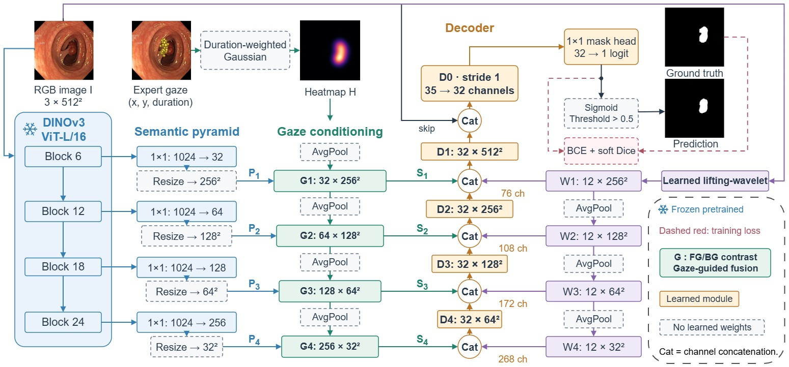

# GazeLIFT

<p align="center">
  
</p>

<p align="center">
  <a href="https://mohammedoussamaben.github.io/GazeLIFT/"></a>
  <a href="https://huggingface.co/spaces/oussamab2n/GazeLIFT"></a>
  
  
  
</p>

GazeLIFT segments polyps and prostate MRI slices using images and gaze fixations. The model combines frozen DINOv3 features, duration-weighted gaze conditioning, learnable lifting wavelets and a trainable decoder.

## Architecture

The input is a 512×512 RGB image and a set of gaze fixations. Features from DINOv3 ViT-L/16 blocks 6, 12, 18 and 24 are projected and conditioned through foreground/background prototype contrast. A learnable lifting-wavelet branch supplies image features. The decoder combines these inputs to produce a segmentation logit map.

| Component | Configuration |
| --- | --- |
| Frozen encoder | DINOv3 ViT-L/16; blocks 6, 12, 18, 24 |
| Gaze representation | Duration-weighted Gaussian heatmap; per-image duration normalization |
| Semantic adaptation | Gaze-conditioned foreground/background prototype contrast |
| Boundary branch | Learnable separable lifting wavelet, 8 scalar parameters |
| Decoder | Compact transposed-convolution decoder with RGB skip |
| Trainable parameters | 817,993; frozen encoder excluded |

Gaze records are required at inference. The model expects four frozen 1024-channel DINO maps and images whose spatial dimensions are divisible by 16.

## Repository layout

```text
model_code/           Model architecture, data pipeline, training and evaluation code
docs/                 Website source and figures
```

## Load the architecture

```python
import sys
sys.path.insert(0, "model_code")

from model import TransposeCNNGazePyramidDecoder

model = TransposeCNNGazePyramidDecoder()
assert sum(p.numel() for p in model.parameters() if p.requires_grad) == 817_993
```

Training and evaluation require feature caches, image files, fixation records and dataset manifests. These data are not included.

## Segmentation demo

The [Hugging Face demo](https://huggingface.co/spaces/oussamab2n/GazeLIFT) accepts images, DICOM slices and fixation records. It runs the trained Kvasir-SEG or NCI-ISBI adapter on ZeroGPU and returns a mask, overlay and gaze prior. The [weights and manifest](https://huggingface.co/spaces/oussamab2n/GazeLIFT/tree/main/weights) are stored in the Space.

The [project website](https://mohammedoussamaben.github.io/GazeLIFT/) contains the method description and experimental results.

## Results

The main configuration achieves **93.35% Dice on Kvasir-SEG** and **89.24% on NCI-ISBI**. Across 15 training runs (seeds 40–54), mean Dice is **93.22 ± 0.44%** and **87.94 ± 0.79%**, respectively (mean ± SD across runs). Evaluation details are on the [project website](https://mohammedoussamaben.github.io/GazeLIFT/#results).

## Data and backbone access

Obtain the datasets and DINOv3 backbone separately under their respective access and licensing terms. Trained adapter weights are linked above.
