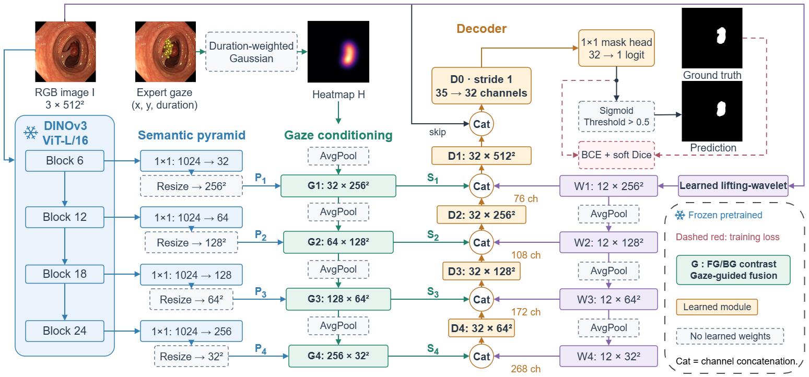

# GazeLIFT

<p align="center">
  
</p>

<p align="center">
  <a href="https://mohammedoussamaben.github.io/GazeLIFT/"></a>
  
  
  
</p>

GazeLIFT is a trained, gaze-guided medical image segmentation model. It uses expert fixation locations and durations to condition frozen multi-depth DINOv3 features, then combines them with a learnable lifting-wavelet branch and compact decoder.

## Architecture

The model receives a 512×512 RGB image and gaze fixations. Features from DINOv3 ViT-L/16 blocks 6, 12, 18 and 24 are projected and conditioned through foreground/background prototype contrast. A single learnable lifting-wavelet transform preserves local image structure. The decoder fuses these sources to produce a segmentation logit map.

| Component | Configuration |
| --- | --- |
| Frozen encoder | DINOv3 ViT-L/16; blocks 6, 12, 18, 24 |
| Gaze representation | Duration-weighted Gaussian heatmap; per-image duration normalization |
| Semantic adaptation | Gaze-conditioned foreground/background prototype contrast |
| Boundary branch | Learnable separable lifting wavelet, 8 scalar parameters |
| Decoder | Compact transposed-convolution decoder with RGB skip |
| Trainable parameters | 817,993; frozen encoder excluded |

Gaze records are required at inference. The model expects four frozen 1024-channel DINO maps and images whose spatial dimensions are divisible by 16.

## Repository layout

```text
reproduction/seed42/  Original architecture, data pipeline, training and evaluation code
docs/                 GitHub Pages source and project visuals
```

## Inspect the model

```python
import sys
sys.path.insert(0, "reproduction/seed42")

from model import TransposeCNNGazePyramidDecoder

model = TransposeCNNGazePyramidDecoder()
assert sum(p.numel() for p in model.parameters() if p.requires_grad) == 817_993
```

The training and evaluation scripts expect prepared feature caches, image files, fixation records and dataset manifests. They intentionally do not train on or evaluate against any data included in this repository.

## GazeLIFT interface

The separately distributed GazeLIFT Hugging Face interface supports image/DICOM upload, fixation clicks and tabular gaze import. It loads verified Kvasir-SEG and NCI-ISBI trained adapters. Adapter distribution and the live Space are pending.

## Related project

[GazeRefine](https://github.com/MohammedOussamaBEN/GazeRefine) provides a related gaze-guided segmentation framework and interface. GazeLIFT uses a trained adapter with multi-depth semantic conditioning, lifting-wavelet features and a compact decoder. The two methods use different inference architectures and their checkpoints are not interchangeable.

## Data and backbone access

Medical datasets, trained adapters and DINOv3 backbone weights are not bundled here. Obtain them under their respective permissions and licenses. Do not redistribute them without authorization.
